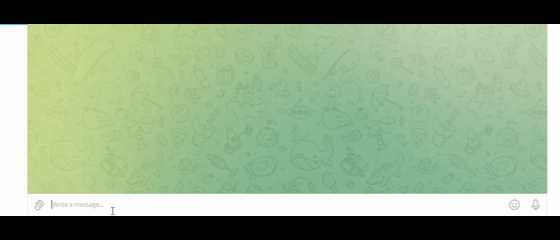

# ToDoTelegramBot

Личный таск-трекер в Telegram: любое сообщение превращается в задачу с кнопками, бот напоминает
о ней в нужное время и продолжает напоминать, пока задачу не закроют. Дополнительно есть Mini App,
LLM-ассистент (локальная модель через OpenAI-совместимый API) и MCP-сервер, через который задачами
могут управлять Claude Code, Codex и другие агенты.



## Возможности

- **Задача из любого сообщения**: текст, фото, файл, голосовое. Время можно указать прямо в тексте:
  «позвонить Ивану завтра в 11», «отчёт через 2 часа», «стендап по будням в 10:00»,
  «оплатить 15.10 в рабочее время», «планёрка каждый понедельник в 11».
- **Голос, видео, кружки и картинки.**
  - Звук (у видео только звуковая дорожка) расшифровывается локальным whisper `large-v3-turbo` со словарём
    подсказок (`/vocab`, тексты последних задач) и консервативной автокоррекцией через LLM.
  - Можно подключить расшифровку Telegram Premium от имени вашего аккаунта (userbot,
    `python -m todobot.userbot login`, нужны `TG_API_ID` и `TG_API_HASH` с my.telegram.org). Бот сам расшифровку
    Telegram прочитать не может: у Bot API нет такого метода.
  - Кнопка ✏️ на карточке (или ответ `= текст`) подставляет свой текст, например скопированную расшифровку Premium.
  - Текст с картинок распознаёт vision-модель шлюза.
  - Карточка бота — это оригинал плюс подпись: ваш текст, распознанный текст, время и `#id`. Длинный текст
    приходит ответом под карточкой.
  - `/recognize` распознаёт заново старые или неудачные задачи.
- **Несколько дел в одном сообщении.** Голосовое, в котором надиктовано несколько дел («позвонить…, потом…, и ещё…»),
  разбивается локальной LLM на отдельные задачи, у каждой своё время. Текст списком («- …», «1. …») тоже становится
  несколькими задачами. Под отчётами агентов есть кнопки ✔️ для каждой упомянутой задачи (`#id`).
- **Планы на недели, месяцы и год, идеи.** Бот понимает «на следующей неделе», «в конце месяца», «в ноябре»,
  «в середине ноября», «15 ноября», «в следующем году», «в 2027 году»: напоминает в начале периода, а в карточке
  пишет «📆 ноябрь». «Идея: …» и «… когда-нибудь» сохраняются без напоминаний в `/ideas`. Длинный план текстом
  или голосом разбирается на отдельные задачи. В Claude Code для этого есть skill `todo-plan`, в Codex —
  `/prompts:plan`; оба складывают задачи в бот через MCP `add_tasks`.
- **Если время не указано, напоминание ставится через +24 ч** (`DEFAULT_REMIND_HOURS`).
- **Работа с конкретной задачей:** ответьте на её карточку текстом («перенеси на пятницу», «? о чём это»)
  или командой `/claude …`. Агентам задача доступна по `#id` через MCP (`get_task`, `download_attachment`).
- **Два режима интерфейса** (переключаются через `/mode`):
  - **кнопки в чате**: ✔️ Готово · ⏰ Когда · ✏️ текст · ❌. В «Когда» есть пресеты (+15 мин, +1 час, вечером,
    завтра, начало рабочего дня, понедельник), календарь со временем, повторы, режим
    «только в рабочее время» и «🤖 Поручить Claude / Codex»;
  - **Mini App**: список, редактор, настройки и чат с ассистентом. Кнопка «⏰ Когда» и кнопка меню
    открывают приложение.
- **Напоминания с «пинками»**: сработавшая карточка поднимается вниз чата с кнопками 💤
  и повторяется каждые `NAG_MINUTES`, но не больше `MAX_NAGS` раз.
- **Повторы**: каждый день, по будням, раз в неделю, раз в месяц.
- **Рабочий день**: свои часы, дни и часовой пояс у каждого пользователя. Утром бот присылает план
  (просроченное, сегодня, дальше, без срока), вечером итог и кнопку «перенести несделанное на утро».
  После `/orchestrate claude` утренний и вечерний разбор делает коворкер (см. ниже).
- **Разбор и чистка** (`/review`): список того, что ждёт решения (просроченные, давно без срока, нераспознанные),
  чистка чата ботом (служебные карточки и выполненные больше недели назад; сообщения старше 48 ч Telegram удалить
  не даёт, их бот сворачивает) и решение по одной: задачи приходят вниз чата с прогрессом «3/12».
- **Переход к задаче**: в `/today`, `/list`, `/ideas` и под отчётами агентов у каждой задачи есть кнопка 📍,
  которая поднимает её карточку вниз чата (ссылок на сообщения в личном чате с ботом Telegram не даёт).
  Задачи с флагом «в рабочее время» вне рабочих часов не беспокоят, а переносятся на начало дня.
- **LLM-ассистент** (`/ai …` или сообщение, начинающееся с `?`): знает ваши задачи и график,
  помнит контекст диалога (последние `LLM_HISTORY` реплик), сам вызывает инструменты (создать,
  перенести, закрыть, удалить). `/smart on` включает разбор новых задач через LLM вместо regex-парсера.
- **MCP-сервер**: те же инструменты для Claude Code, Codex и любых MCP-клиентов, по stdio и по HTTP.
  Агент может сам ставить задачи, напоминания и писать вам в Telegram (`notify`).

## Архитектура

```
todobot/
  __main__.py      запуск: бот (polling) + веб (Mini App, /mcp) в одном event loop
  config.py        настройки (.env)
  models.py        Task, UserSettings
  service.py       бизнес-логика задач (единая для бота, webapp, LLM, MCP)
  timeparse.py     разбор «завтра в 10», «по будням», «в ноябре», «на следующей неделе», идеи, ISO
  timeutil.py      часовые пояса, рабочий день, повторы
  split.py         несколько задач в одном сообщении (список или разбор LLM)
  stt.py           расшифровка: faster-whisper локально или OpenAI-совместимый /audio/transcriptions
  userbot.py       расшифровка Telegram Premium от имени аккаунта (Telethon), вход: python -m todobot.userbot login
  media.py         звуковая дорожка из видео/аудио (PyAV), декодирование для whisper
  tools.py         инструменты: используются и MCP-сервером, и LLM-агентом
  mcp_server.py    MCP (stdio; HTTP монтируется в веб-сервер)
  worker.py        очередь заданий для чатов-коворкеров: --wait (ждать задание) и --report (сдать отчёт)
  storage/         Mongo (async pymongo) и in-memory
  llm/             OpenAI-совместимый клиент и агент с tool-calling
  bot/             хендлеры, карточки, клавиатуры, фоновые задачи, extract.py — распознавание медиа
  web/             FastAPI: REST для Mini App (проверка initData), API воркера, страница приложения
docs/coworker.md   коворкеры: воркер, чат-коворкер, оркестрация дня
agent-context/     журналы контекста чатов-коворкеров (в git не попадает)
mailbox/           письма между Claude и Codex (протокол в mailbox/README.md)
data/              сессия userbot, модели whisper, вложения (в git не попадает)
```

Изменения, сделанные вне чата (Mini App, MCP, LLM), помечают задачу флагом `card_dirty`, а сообщения
агентов кладутся в `outbox`. Процесс бота раз в 5 секунд перерисовывает карточки и отправляет
сообщения. Поэтому stdio-MCP-процессу не нужен токен бота, хватает доступа к той же базе.

Старые записи (формат `date: "%d-%m-%Y %H:%M"`) автоматически мигрируются при старте, кнопки старых
карточек продолжают работать.

## Запуск

```bash
cp .env.example .env   # заполнить TOKEN, OWNER_CHAT_ID, Mongo
docker compose up -d --build
```

С подключением к `llm-gateway` (бот входит в его docker-сеть `llm-gateway_llm-net`):

```bash
docker compose -f docker-compose.yml -f docker-compose.llm.yml up -d --build
```

Локально без Docker:

```bash
python -m venv .venv && .venv/Scripts/pip install -r requirements-dev.txt
python -m todobot
```

Для отладки Mini App без Telegram и Mongo: `STORAGE=memory RUN_BOT=false WEBAPP_DEV_USER_ID=1 python -m todobot`,
затем откройте http://localhost:8080. Готовая конфигурация лежит в `.claude/launch.json`.

Тесты: `python -m pytest`. Защита от коммита секретов (`.env`, токены ботов) включается один раз:
`git config core.hooksPath .githooks`.

Данные контейнера (`./data`): сессия userbot (это ключ к аккаунту, не публикуйте), кэш моделей whisper
(`large-v3-turbo` около 1,6 ГБ, скачивается при первой расшифровке), вложения для агентов.

### Mini App

1. Опубликуйте веб-порт по https. В `nginx/conf/default.conf` уже есть `location /app/` с прокси на бота.
2. Пропишите `WEBAPP_URL=https://<домен>/app/` (со слешем на конце).
3. В BotFather при желании задайте Menu Button / Mini App на тот же адрес.
4. В чате выполните `/mode` или выберите режим в настройках приложения.

### LLM

Подойдёт любой OpenAI-совместимый `/v1/chat/completions` с поддержкой tools: llm-gateway,
llama.cpp, Ollama, vLLM, OpenRouter.

| Переменная | Пример |
|---|---|
| `LLM_BASE_URL` | `http://llmgw-gateway:8080/v1` (из docker-сети), `http://localhost:8091/v1` (с хоста) |
| `LLM_MODEL` | `general35`: без «размышлений», с tools, быстрый. Можно `tag:free` или облачную модель |
| `LLM_EXTRA_BODY` | `{"chat_template_kwargs":{"enable_thinking":false}}` для reasoning-моделей |
| `LLM_TIMEOUT` | 300: запас на холодную загрузку модели в llama-swap |

## Коворкеры: Claude Code и Codex по подписке

Простое бот делает сам на локальной LLM, а сложное отдаёт Claude Code или Codex на вашем ПК:
`/claude [папка] задание`, `/codex …`, кнопка «🤖 Поручить» у задачи, или ассистент решает сам.
Отчёт приходит в Telegram, а ответ на него продолжает разговор с агентом.
Исполнитель — открытый чат в десктопном приложении Claude или Codex («чат-коворкер»): он ждёт задания
без расхода токенов и держит контекст. Если приложение закрыто, бот так и скажет, а разборы дня не копятся.
Подробности описаны в [docs/coworker.md](docs/coworker.md).

`/model` выбирает модель ассистента: только локальные и бесплатные облачные из `llm-gateway`.
`LLM_FALLBACK_MODEL` задаёт запасную модель на случай, если основная недоступна.

## MCP: подключение к Claude Code и Codex

Инструменты:
- задачи: `list_tasks`, `search_tasks`, `get_agenda`, `get_task`, `add_task`, `add_tasks` (пакетом: планы и идеи),
  `list_ideas`, `complete_task`, `reopen_task`, `delete_task`, `edit_task`, `set_reminder`, `snooze_task`;
- вложения: `download_attachment` (файл задачи в `data/files`, путь на ПК);
- настройки и связь: `get_settings`, `update_settings`, `notify`;
- коворкеры: `delegate_to_agent`, `list_agent_jobs`, `agent_inbox`, `agent_report`.

Задачу можно указать по id, по `#префиксу` с карточки или по номеру сообщения-карточки.

**HTTP — основной способ.** MCP встроен в процесс бота (`/mcp`, streamable HTTP без сессий): один сервер
на все чаты Claude и Codex, отдельных процессов и лишней памяти нет. С этой машины токен не нужен: порт открыт
только на `127.0.0.1`, а запросы хоста бот узнаёт по адресу шлюза docker-сети (`MCP_TRUST_HOST=true`).
Остальным (другим контейнерам, сети) нужен `Authorization: Bearer <MCP_TOKEN>`.

```bash
claude mcp add --transport http -s user todo http://localhost:8088/mcp
```

Codex (`~/.codex/config.toml` или проектный `.codex/config.toml`):

```toml
[mcp_servers.todo]
url = "http://localhost:8088/mcp"
```

В проекте это уже прописано в `.mcp.json` и `.codex/config.toml`.

**stdio — только если HTTP недоступен.** `docker exec -i todobot python -m todobot.mcp_server` запускает
в контейнере отдельный Python-процесс (~40–60 МБ) на каждую сессию клиента. При десятке открытых чатов
это гигабайт памяти.

Примеры запросов агенту: «поставь мне задачу на завтра в 10 проверить CI по этой ветке»,
«что у меня сегодня по плану?», «когда закончишь рефакторинг, напиши мне в телеграм и поставь
задачу на ревью в рабочее время».

## Команды бота

| Команда | Что делает |
|---|---|
| `/list` | открытые задачи: 📍 поднять карточку, ✔️ закрыть |
| `/today` | план: просроченное, сегодня, дальше, без срока (с кнопками 📍 и ✔️) |
| `/ai вопрос`, `? вопрос` | ассистент |
| `/mode [buttons\|webapp]` | режим интерфейса |
| `/app` | открыть Mini App |
| `/work 09:00-18:00 1-5` | рабочие часы и дни (1 = Пн) |
| `/digest on\|off` | утренний план и вечерний итог |
| `/tz Europe/Moscow` | часовой пояс |
| `/smart on\|off` | разбор новых задач через LLM |
| `/forget` | очистить память ассистента |
| `/help` | справка |
| `/claude [папка] задание`, `/codex …` | поручить коворкеру (можно ответом на карточку) |
| `/agents` | статусы поручений, отмена |
| `/orchestrate claude\|codex\|off` | кто делает утренний и вечерний разбор дня |
| `/model` | модель ассистента (локальные и бесплатные) |
| `/recognize` | распознать голос или фото в задачах (ответом на карточку — только её) |
| `/ideas` | идеи без срока |
| `/review` | разбор задач: бот убирает служебные и давно выполненные карточки, остальное показывает по одной (сделано / срок / в идеи / удалить) |
| `/vocab слово, Имя, термин` | словарь для распознавания речи (`/vocab -слово` убирает) |
| ответ `= текст` на карточку | свой текст или расшифровка (например, скопированная из Telegram Premium) |

## Kubernetes

Манифесты лежат в `k8s/`. Секрет создаётся так:

```bash
kubectl create secret generic telegramcalendar-secret -n telegramcalendar \
  --from-literal=TOKEN=<bot-token> --from-literal=MONGO_USER=<user> --from-literal=MONGO_PASS=<pass>
kubectl apply -f k8s/
```

Остальное настраивается в `k8s/telegramcalendar-config.yaml`. Добавился Service на порт 8080
(Mini App и `/mcp`) с health-пробами `/healthz`.

> Манифесты отстают от docker-compose: нет тома для `/app/data`, а лимита памяти 512 МБ не хватит для
> локального whisper. Для k8s либо задайте `STT_PROVIDER=off` / `openai`, либо увеличьте память и добавьте PVC.
